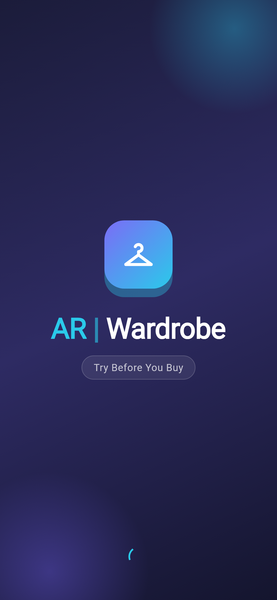
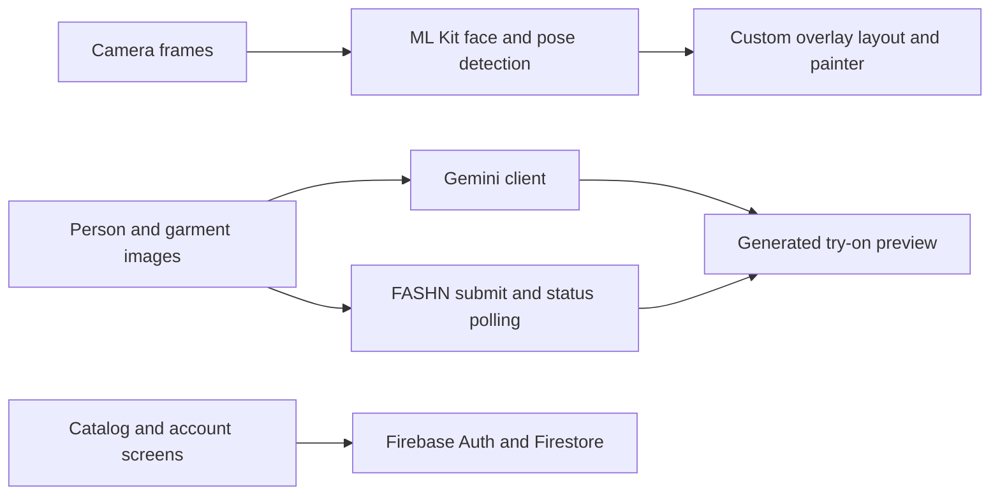

# AR Wardrobe

A Flutter virtual wardrobe prototype combining camera-based clothing overlays, an asset-backed brand catalog, saved outfits, and AI try-on service integrations.

It demonstrates native camera/ML integration alongside asynchronous image-generation APIs and Firebase-backed account and shopping flows.

## Mobile interface preview

The mobile launch experience establishes the AR Wardrobe identity and its “Try Before You Buy” virtual-fitting proposition.

<p align="center">
  
</p>

## Features and stack

- Live camera, face/pose detection, and custom overlay painting.
- Brand/product browsing, cart, orders, and saved-outfit screens.
- Firebase Authentication and Cloud Firestore.
- Gemini image-generation and FASHN virtual try-on clients.
- Flutter / Dart `^3.10.8`, Provider, Google ML Kit, `camera`, `image_picker`, `http`, and `flutter_dotenv`.

## Architecture



The checked-in application is under `ar_wardrobe_frontend/`. Camera/detection services, coordinate utilities, painters, and try-on state are separate modules. The AI service clients call external providers directly; no server proxy is included.

## Setup

```sh
git clone https://github.com/Abdul-Hadi-Jalil/AR-Wardrobe.git
cd AR-Wardrobe/ar_wardrobe_frontend
flutter pub get
flutter devices
```

Configure Firebase for your own project, enabled authentication provider, native app identifiers, and Firestore access rules. Use an Android/iOS device supported by the camera and ML Kit plugins; generated web/desktop runners do not imply these features work there.

Copy `.env.example` to a local `.env` and provide your own `GCP_API_KEY` and `FASHN_API_KEY` when testing the AI integrations. Never commit actual provider keys.

```sh
flutter run -d <device-id>
```

### Current AI setup limitations

The current code needs attention before a successful Gemini demo:

- `ApiConfig.hasKey` compares the loaded Gemini key with the same environment value, so a normally configured key is rejected by that guard.
- `main.dart` loads `.env` optionally, but `pubspec.yaml` does not register `.env` as an asset. Loading from a local file alone therefore does not establish that the values reach a packaged app.
- Provider keys in client assets are extractable. A server-side proxy is needed for protected production credentials.

These are implementation limitations; documentation does not modify them. The FASHN client submits `/run` jobs and polls `/status/{id}`, returning errors or generated bytes through the shared result type.

## Code map

| Directory | Role |
| --- | --- |
| `lib/screens/` | Camera, try-on, catalog, account, cart, orders |
| `lib/services/` | Camera, ML Kit, Firebase, Gemini, FASHN |
| `lib/painters/` and `lib/utils/` | Overlay geometry and drawing |
| `lib/models/` | Products, prices, orders, outfits |
| `lib/state/` | Try-on selection state |
| `assets/` | Bundled catalog and branding |

## Verification and demo scope

```sh
flutter analyze
flutter test
flutter build apk --debug
```

Run these inside `ar_wardrobe_frontend/`. Manually validate camera permissions, overlay alignment, catalog navigation, account isolation, and each AI provider separately after resolving configuration issues. AI calls may transmit person/garment images to the selected provider.

Virtual try-on previews are visual approximations; the repository does not demonstrate physical sizing accuracy, payment processing, or production order fulfillment.
